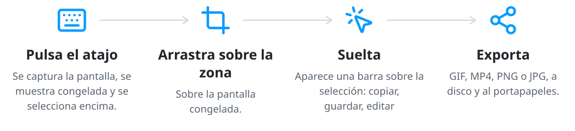
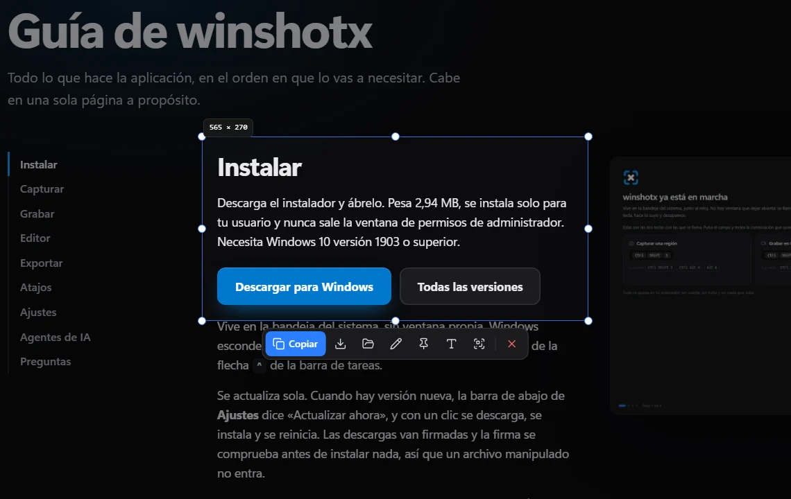
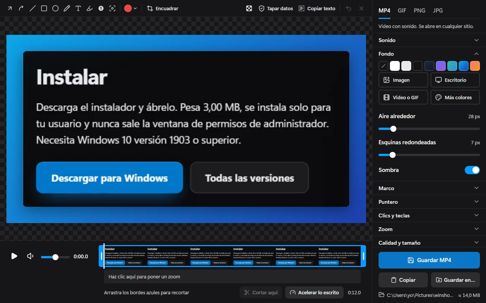
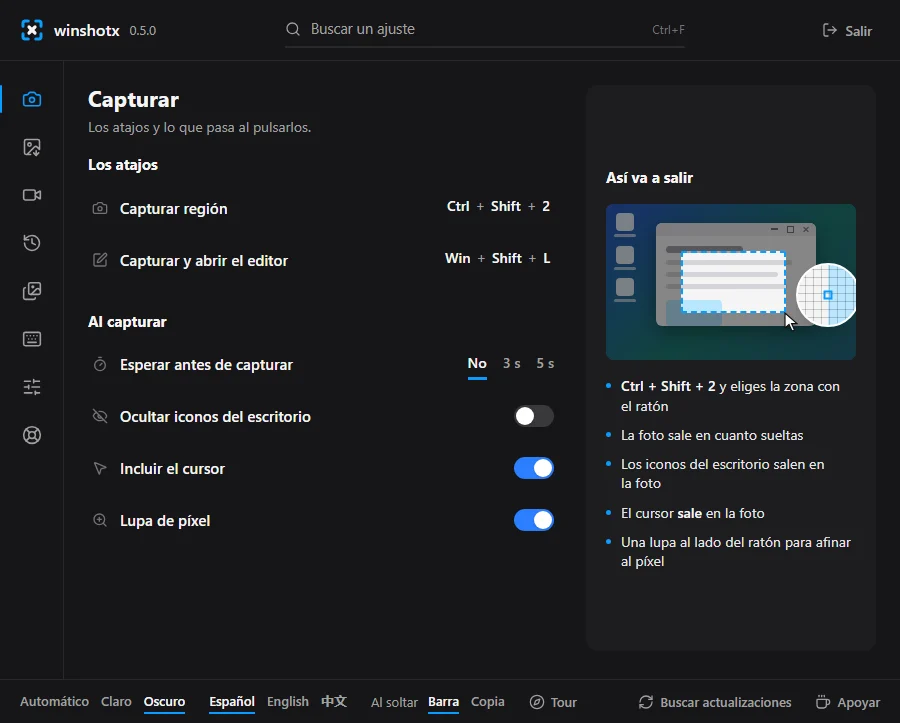

<div align="center">

<picture><source media="(prefers-color-scheme: dark)" srcset="docs/img/logo.svg"></picture>

# winshotx

**Recorta la pantalla antes de que parpadees**

Una **alternativa libre a la Herramienta de Recortes de Windows**: captura de región con lupa de
píxel, **grabación en GIF y MP4** y un editor con estudio. Enseña la selección ya pintada
114 ms después del atajo con tres pantallas, gasta 33 MB de memoria y cabe en un instalador de
3,03 MB. Sin cuenta, sin nube, sin telemetría y sin FFmpeg empaquetado.

<a href="https://github.com/Mun1to/winshotx/releases/latest/download/winshotx-setup.exe"><picture><source media="(prefers-color-scheme: dark)" srcset=".github/readme/download-windows-dark.es.svg"></picture></a>
<a href="https://github.com/Mun1to/winshotx/releases/latest"><picture><source media="(prefers-color-scheme: dark)" srcset=".github/readme/download-linux-dark.es.svg"></picture></a>
<a href="https://winshotx.com/"><picture><source media="(prefers-color-scheme: dark)" srcset=".github/readme/download-web-dark.es.svg"></picture></a>
<a href="https://apps.microsoft.com/detail/9P1NKWNRXD6Z"><picture><source media="(prefers-color-scheme: dark)" srcset="https://get.microsoft.com/images/es%20light.svg"></picture></a>

[Licencia MIT](LICENSE) · Windows 10 y 11, y Linux · Instalador 3,03 MB

[Comparar con la Herramienta de Recortes](#herramienta-de-recortes-contra-winshotx) · [Última versión](https://github.com/Mun1to/winshotx/releases/latest) · [English](README.md)

</div>

https://github.com/user-attachments/assets/2a3ba06b-3d6c-4e22-9379-8a0e89b5d258

## Cómo funciona

<p align="center"><picture>
<source media="(prefers-color-scheme: dark) and (max-width: 600px)" srcset=".github/readme/how-it-works-dark-narrow.es.svg">
<source media="(max-width: 600px)" srcset=".github/readme/how-it-works-light-narrow.es.svg">
<source media="(prefers-color-scheme: dark)" srcset=".github/readme/how-it-works-dark.es.svg">

</picture></p>

**La interfaz habla español, inglés y chino**, y arranca en el que tenga puesto Windows; la barra de
abajo de los ajustes fija otro. Los identificadores y los comentarios del código están en español; los
commits y la portada en inglés van aparte.

## Qué hace

### Captura sobre la pantalla congelada

<p align="center"></p>

Pulsa <kbd>Ctrl</kbd> + <kbd>Mayús</kbd> + <kbd>2</kbd> y la pantalla se congela, así que nada se mueve mientras arrastras. Una **lupa de 6×** enseña el color exacto bajo el puntero y `C` lo copia, y un clic se lleva una **ventana entera**. Al soltar sale una barra para copiar, guardar, editar, anclar o leer el texto.

- `F`, `G` y `V` eligen qué sale antes de recortar: foto, GIF o vídeo.
- `S` saca una **página larga**, bajando sola. `X` fija el recorte a 16:9, 1:1, 9:16 o 4:3.
- Sin barra, si lo prefieres: la captura va directa al portapapeles. La bienvenida lo pregunta la primera vez.
- ¿Prefieres pulsar **Impr Pant** o **Win + Mayús + S**? **Ajustes > Teclas de Windows** se las quita a la Herramienta de Recortes, y se las devuelve.

### Graba, y luego edita con un estudio

<p align="center"></p>

Graba una zona, una pantalla entera o **una sola ventana**, aunque algo la tape. El sonido del PC y el micrófono van **cada uno en su pista**, y tu cámara puede ir encima. El editor recorta en una línea de tiempo, **se acerca a cada clic** y pone fondo, esquinas redondeadas, sombra y un puntero suave, todo **a la vista** antes de exportar a MP4 o GIF.

### Unos ajustes que enseñan lo que hacen

<p align="center"></p>

Ocho apartados, un **buscador** (`Ctrl+F`) que encuentra cualquier ajuste por su nombre y, a la derecha, **Así va a salir** dibuja lo que estás eligiendo antes de probarlo.

### Y además

- **Tapar datos personales.** Un clic encuentra los correos, teléfonos, tarjetas, cuentas bancarias y DNI, en una imagen o en un vídeo, y el mosaico **destruye los píxeles** en vez de emborronarlos. Una tarjeta tiene que pasar su dígito de control, así que una factura no sale tapada a medias.
- **Los últimos segundos.** Puede grabar todo el rato en memoria, y `Ctrl+Mayús+6` se queda con los últimos 15, 30 o 60 segundos. Lo bueno casi siempre pasa **antes** de que nadie dé a grabar.
- **El texto de una imagen.** `T` lo lee con el OCR de Windows y lo copia, también en una grabación.
- **Anclar una captura.** `A` la deja flotando encima de todo, justo donde estaba.
- **Once marcas.** Flechas, rectángulos, texto, resaltador, foco, mosaico y pasos numerados que se renumeran solos.
- **Más rápido donde no pasa nada.** Exporta a 0,5×, 2× o 4×, o pulsa **Acelerar lo escrito**.
- **Una cuenta atrás.** 3 o 5 segundos antes de congelar la pantalla, para fotografiar un menú abierto.
- **Se pega donde lo necesitas.** Una imagen se pega como imagen, y un GIF o un MP4 como **archivo** en Slack, Discord o el Explorador.
- **Todo se queda en tu PC.** Ni cuenta, ni telemetría, ni subidas: lo único que sale a la red es mirar si hay versión nueva en GitHub.

## Herramienta de Recortes contra winshotx

Mismo equipo con Windows 11, tres pasadas cada una y las dos arrancando desde cero. El cronómetro
para cuando la selección ya se ve en pantalla. La [comparativa entera](https://winshotx.com/#comparativa)
pone a winshotx contra otras diez, fila a fila, y dice dónde gana cada una.

|  | winshotx | Herramienta de Recortes |
|---|---|---|
| Del atajo a la selección en pantalla, ya pintada (tres pantallas) | **114 ms** | 920 ms |
| Memoria mientras capturas | **33 MB** | 253 MB |
| Memoria esperando quieta | **31 MB** | 98 MB |
| Un vídeo con zooms que siguen a los clics, y su fondo | **sí** | no |
| Los últimos segundos, sin haber dado a grabar | **15, 30 o 60 s** | no |
| Grabar GIF | **sí** | solo en Insider, 30 s |
| Tapar datos personales | **solo, en imágenes y vídeos** | correos y teléfonos |
| Dibujar encima | **once marcas, con texto y pasos numerados** | sin texto ni pasos |
| Una página larga, bajando sola | **sí** | no |
| Sonido del PC y micrófono | **cada uno en su pista** | sí |
| Elegir tu propio atajo | **sí** | no |
| La maneja un agente de IA | **sí** | no |
| Cuenta atrás antes de capturar | 3 o 5 segundos | **3, 5 o 10 segundos** |
| Viene puesta con Windows | no | **sí** |
| Idiomas | 3 | **64** |

## Atajos

| Atajo | Qué hace |
|---|---|
| <kbd>Ctrl</kbd> + <kbd>Mayús</kbd> + <kbd>2</kbd> | Capturar una zona |
| <kbd>Win</kbd> + <kbd>Mayús</kbd> + <kbd>L</kbd> | Capturar e ir directo al editor |
| <kbd>Ctrl</kbd> + <kbd>Mayús</kbd> + <kbd>5</kbd> | Grabar una zona · otra vez para parar |
| <kbd>Ctrl</kbd> + <kbd>Mayús</kbd> + <kbd>6</kbd> | Quedarte con los últimos segundos · si ese anillo está encendido |
| <kbd>Ctrl</kbd> + <kbd>Mayús</kbd> + <kbd>9</kbd> | Acercarse mientras grabas |
| <kbd>Impr Pant</kbd> · <kbd>Win</kbd> + <kbd>Mayús</kbd> + <kbd>S</kbd> | Capturar una zona · cuando **Ajustes > Teclas de Windows** se las queda |

Todos se cambian en los ajustes: pulsa el campo y teclea la combinación nueva. Si otro programa ya la tiene, el campo se pone rojo y lo dice.

<details>
<summary><b>Mientras eliges la zona</b></summary>

| Tecla | Qué hace |
|---|---|
| <kbd>Intro</kbd> | Copiar la selección |
| <kbd>Ctrl</kbd> + <kbd>S</kbd> | Guardarla en la carpeta de capturas |
| <kbd>Ctrl</kbd> + <kbd>Mayús</kbd> + <kbd>S</kbd> | Guardarla donde quieras |
| <kbd>E</kbd> | Abrirla en el editor |
| <kbd>A</kbd> | Anclarla encima de todo |
| <kbd>T</kbd> | Copiar el texto que lleva dentro |
| <kbd>C</kbd> | Copiar el color bajo el puntero |
| <kbd>F</kbd> / <kbd>G</kbd> / <kbd>V</kbd> | Foto, GIF o vídeo |
| <kbd>W</kbd> | Grabar solo la ventana bajo el puntero, aunque algo la tape |
| <kbd>S</kbd> | Una página larga, bajando sola |
| <kbd>X</kbd> | Fijar el recorte: libre, 16:9, 1:1, 9:16 o 4:3 |
| <kbd>R</kbd> | La misma zona que la última vez |
| <kbd>P</kbd> | Una pantalla entera: cada monitor enseña su número, y <kbd>1</kbd>, <kbd>2</kbd> o <kbd>3</kbd> se la lleva |
| <kbd>B</kbd> | Enseñar u ocultar la barra |
| <kbd>Ctrl</kbd> + <kbd>A</kbd> | El monitor entero |
| <kbd>←</kbd> <kbd>↑</kbd> <kbd>></kbd> <kbd>↓</kbd> | Mover la selección · <kbd>Mayús</kbd> de 10 en 10 · <kbd>Alt</kbd> cambia el tamaño |
| <kbd>Esc</kbd> | Cancelar |

</details>

<details>
<summary><b>En el editor, y en una captura anclada</b></summary>

| Tecla | Qué hace |
|---|---|
| <kbd>Espacio</kbd> | Reproducir el trozo que te quedas |
| <kbd>I</kbd> / <kbd>O</kbd> | Cortar la entrada y la salida donde está la vista previa |
| <kbd>←</kbd> <kbd>></kbd> | Un fotograma atrás o adelante |
| <kbd>1</kbd> a <kbd>0</kbd> | Flecha, rectángulo, texto, resaltador, paso numerado, mosaico, flecha curva, línea, elipse y lápiz |
| <kbd>F</kbd> | Foco: oscurece todo lo demás |
| <kbd>C</kbd> | Encuadrar la imagen |
| <kbd>T</kbd> | Copiar el texto de la imagen |
| <kbd>D</kbd> | Tapar los datos personales que encuentre |
| <kbd>Ctrl</kbd> + <kbd>Z</kbd> | Deshacer la última marca |
| <kbd>Ctrl</kbd> + <kbd>S</kbd> | Exportar con lo que tenga puesto el panel |
| <kbd>Ctrl</kbd> + <kbd>Mayús</kbd> + <kbd>S</kbd> | Exportar preguntando antes dónde |
| <kbd>Esc</kbd> | Soltar el encuadre o la herramienta, y luego cerrar |

En una captura anclada, <kbd>Ctrl</kbd> + <kbd>C</kbd> la copia, <kbd>Ctrl</kbd> + <kbd>S</kbd> la guarda, <kbd>T</kbd> copia su texto y <kbd>Esc</kbd> la cierra.

</details>

<details>
<summary><b>Cómo le quita a Windows Impr Pant y Win + Mayús + S</b></summary>

`Impr Pant` es de la Herramienta de Recortes por un valor del registro de cada usuario, así que registrar la tecla sin más parece que funciona y nunca salta. El interruptor borra ese valor y se queda la tecla, y al apagarlo deja el valor exactamente como estaba.

`Win+Mayús+S` la atiende Windows antes que cualquier programa, gancho o atajo. Lo único que se la quita es apagar la S en `DisabledHotkeys`, y eso cuesta `Win+S`, la búsqueda. El escritorio solo lee esa lista al arrancar, así que el botón **Aplicar** reinicia el Explorador: dos segundos, y no se cierra nada más. Al apagarlo vuelve todo como estaba.

Para quitar la Herramienta de Recortes del todo, la app abre la pantalla de Windows donde se hace, y nunca desinstala nada por su cuenta.

</details>

## Instalación

[**Descarga el instalador**](https://github.com/Mun1to/winshotx/releases/latest/download/winshotx-setup.exe)
· 3,03 MB · se instala solo para tu usuario, así que Windows nunca pide permisos de administrador. Las
versiones anteriores están en [Releases](../../releases).

Otras tres formas, la misma app:

- **winget:** `winget install Mun1to.winshotx`
- **[Microsoft Store](https://apps.microsoft.com/detail/9P1NKWNRXD6Z):** Microsoft firma el paquete y la tienda lo mantiene al día.
- **Portable:** `winshotx-<versión>-portable-x64.zip` de [Releases](../../releases): un ejecutable, nada instalado, los ajustes en `%APPDATA%\winshotx`.

Vive en la bandeja del sistema, sin ventana propia: si no la ves, mira detrás de la flecha `^` de la barra de tareas.

**Se actualiza sola.** Cuando sale una versión nueva, los ajustes enseñan un botón, y con un clic se descarga, se instala y reinicia la app. Cada descarga va firmada y la firma se comprueba antes de instalar nada, así que un archivo manipulado se rechaza.

**En Linux**, con X11 o con GNOME en Wayland, cada versión desde la 0.6.0 trae tres paquetes en
[Releases](../../releases/latest):

- **.deb** para Debian y Ubuntu: `sudo apt install ./winshotx_<versión>_amd64.deb`
- **.rpm** para Fedora: `sudo dnf install ./winshotx-<versión>-1.x86_64.rpm`
- **AppImage** para los demás: `chmod +x winshotx_<versión>_amd64.AppImage` y ábrelo. **No guarda vídeo MP4**, solo GIF, PNG y JPG: para MP4, el .deb o el .rpm.

El .deb y el .rpm escriben el MP4 con el GStreamer del sistema. Si le falta su codificador de H.264 (Ubuntu sin `gstreamer1.0-plugins-bad`), el panel de exportar lo dice y da la orden que lo instala. Lo que cambia en Linux, y qué se ha probado dónde, está en [packaging/linux](packaging/linux/README.md), en inglés.

## Para agentes de IA

Un agente de IA (Claude Code, Codex, Cursor o cualquier otro cliente de MCP) puede manejar winshotx
por su cuenta: graba la pantalla, para, saca un MP4 o un GIF ya montado y hace capturas, y se entera
de dónde ha quedado cada archivo. Para añadirlo a Claude Code, escribe esto en PowerShell:

```
claude mcp add --scope user winshotx -- "$env:LOCALAPPDATA\winshotx\winshotx.exe" mcp
```

Es donde lo dejan el instalador y winget, salvo que eligieras otra carpeta (la guía trae una línea
que la encuentra); con la portable, pon la carpeta donde la descomprimiste.
Sin MCP, `winshotx.exe agent` hace lo mismo desde cualquier terminal y contesta con una línea de
JSON. **Una grabación que empieza un agente se ve igual que una tuya**, con el marco y la
barra, así que siempre sabes cuándo se graba la pantalla. Cómo se añade a cada agente, y todas las
órdenes: [docs/AGENTS-API.es.md](docs/AGENTS-API.es.md).

## ¿Es esto lo que buscabas?

- **"Quiero algo mejor que la Herramienta de Recortes."** Es esto, y se abre 8 veces antes. La de
  Windows sigue viniendo puesta y hablando 64 idiomas; la tabla de arriba dice dónde gana cada una.
- **"¿Cómo grabo un GIF de la pantalla en Windows?"** Pulsa `Ctrl+Mayús+5`, arrastra sobre la zona,
  púlsalo otra vez para parar y exporta a GIF desde el editor. Sin instalar FFmpeg.
- **"Necesito un grabador de pantalla ligero."** 33 MB mientras captura y 31 esperando en la
  bandeja.
- **"Algo como ShareX, pero más simple."** Los mismos atajos globales y el mismo
  overlay sobre la pantalla congelada, sin cientos de ajustes.
- **"Quiero sacar un color de la pantalla."** La lupa te da el hexadecimal del píxel bajo el cursor
  con zoom 6×, y `C` lo copia.
- **"¿Sube mis capturas a algún sitio?"** No. Ni cuenta, ni telemetría, ni más red que mirar si hay
  versión nueva en GitHub.

## Cómo está construido

| Capa | Elección | Por qué |
|---|---|---|
| Escritorio | [Tauri 2](https://tauri.app) | binario pequeño, webview del sistema, backend en Rust |
| Actualización | plugin `updater` de Tauri, firmas minisign | un botón, sin salir de la app y sin instalar nada a ciegas |
| Interfaz | React 19 + Vite + Tailwind 4 + framer-motion | ventanas independientes, animación nativa |
| Captura estática | [`xcap`](https://crates.io/crates/xcap) | enumera monitores y ventanas con sus coordenadas reales |
| Grabación | [`windows-capture`](https://crates.io/crates/windows-capture) | Windows Graphics Capture, 60 fps sin coste de CPU |
| MP4 | Media Foundation, H.264 por hardware | 0 MB de dependencias, aceleración del sistema |
| GIF | [`gif`](https://crates.io/crates/gif) + [`color_quant`](https://crates.io/crates/color_quant) | paleta global, dithering y diferencia entre fotogramas |
| Caché de edición | [QOI](https://qoiformat.org) sin pérdida | rápido de escribir y editable fotograma a fotograma |

**El overlay de selección no es una ventana transparente.** Se captura la pantalla, se muestra
congelada y se selecciona encima. Esquiva el bug de transparencia de Tauri v2 en Windows, elimina el
parpadeo del contenido en movimiento y regala una lupa exacta al píxel.

**Nada de FFmpeg empaquetado.** El MP4 lo escribe Media Foundation por hardware y el GIF se genera
en Rust puro con paleta global, dithering Floyd-Steinberg y escritura solo del rectángulo que cambia
entre fotogramas. Si tienes `ffmpeg` en el `PATH`, el editor ofrece además un motor de máxima
calidad (`palettegen`), pero nunca se descarga ni se distribuye.

[`docs/TRAMPAS.md`](docs/TRAMPAS.md) recoge las 52 trampas de Tauri v2 y de Windows que costaron
horas, cada una con cómo se ve, por qué pasa y cómo se arregló: comandos síncronos que congelan la
interfaz, ventanas que no se pueden crear desde el hilo de un atajo global, una CSP que solo falla en
el instalador, una ventana que pide un tamaño sin permiso para pedirlo, y la clave de firma que se pasa
de una forma y no de otra.

**Windows y Linux.** Funciona en Windows 10 1903 o posterior y, desde la 0.6.0, en Linux con X11 o
con GNOME en Wayland. Todo lo que toca el sistema va detrás de `#[cfg(windows)]` o de
`#[cfg(target_os = "linux")]`; lo que cambia en Linux está en [packaging/linux](packaging/linux/README.md), en inglés.

<details>
<summary><b>Desarrollo</b></summary>

```bash
pnpm install
pnpm approve-builds --all
pnpm tauri dev      # arranca la app (vive en la bandeja del sistema)
pnpm tauri build    # instalador NSIS en target/release/bundle/nsis
```

Las pruebas del backend no son de mentira: capturan la pantalla real, graban un clip con Windows
Graphics Capture y exportan GIF y MP4 que luego se vuelven a leer para comprobar que son válidos.

```bash
cd src-tauri
cargo test
```

La página está en [`frontlaxweb/`](frontlaxweb) y la sirve Cloudflare Pages. Cada push pasa las
comprobaciones y solo entonces despliega, así que el inglés, las huellas de los archivos y el
sitemap tienen que cuadrar primero:

```bash
node frontlaxweb/generar-en.mjs      # rehace /en/, el bloque de preguntas y las huellas
python frontlaxweb/generar-social.py # rehace las dos tarjetas de 1200x630
node frontlaxweb/hacer-imagenes.mjs  # rehace las fotos de la app desde dist/, tras pnpm build
```

Para publicar una versión hace falta la clave privada de firma, que **no está en el repositorio** y
sin la cual el actualizador no aceptaría la descarga:

```bash
export TAURI_SIGNING_PRIVATE_KEY="$(cat ~/.tauri/winshotx.key)"
export TAURI_SIGNING_PRIVATE_KEY_PASSWORD=""   # la clave se generó sin contraseña
pnpm tauri build
node scripts/publicar.mjs --publicar   # prepara latest.json y crea la release
```

`publicar.mjs` se niega a seguir si `package.json` y `Cargo.toml` no dicen la misma versión, o si el
`.sig` es más viejo que el instalador, que es lo que pasa cuando compilas sin la clave.

Después de publicar, `node scripts/verificar-firma.mjs` se baja lo que sirve la release de verdad y
comprueba la firma contra la clave pública que lleva la app dentro, con ed25519 sobre BLAKE2b-512.
Firmar con otra clave es el fallo que no da ningún error: el actualizador rechaza en silencio cada
descarga y ninguna copia instalada se mueve.

Los manifiestos de winget están en [`packaging/winget`](packaging/winget).

</details>

## Licencia

[MIT](LICENSE). Úsalo, cámbialo y véndelo si quieres. Hecho por
[Munir Torres](https://munito.dev).

<br>

<p align="center">Hecho por <a href="https://munito.dev"><b>Munir Torres</b></a>. También suyo: <a href="https://adeorq.com">Adeorq</a> · <a href="https://vocript.app">VoCript</a> · <a href="https://github.com/Mun1to/Expoal">Expoal</a> · <a href="https://github.com/Mun1to/hotkeyconfig">hotkeyconfig</a> · <a href="https://github.com/Mun1to/froede">froede</a></p>
