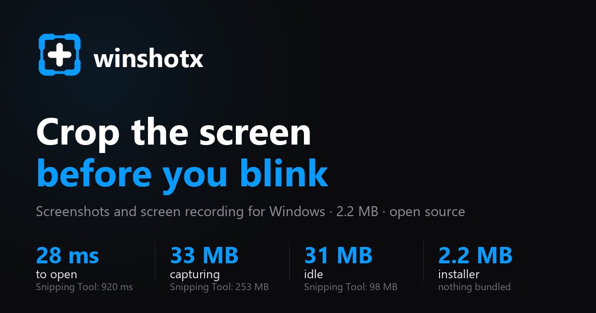
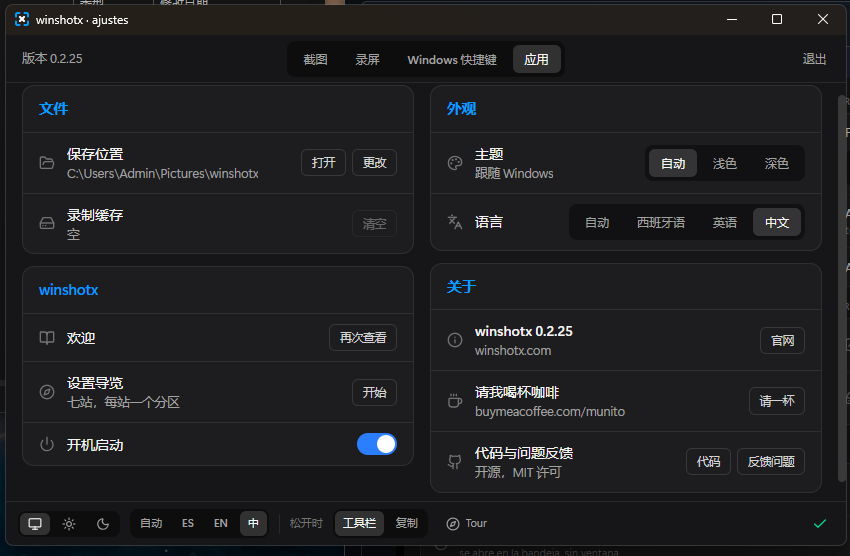

<div align="center">

<picture><source media="(prefers-color-scheme: dark)" srcset="docs/img/logo.svg"></picture>

# winshotx

**Crop the screen before you blink**

A free and open source **Snipping Tool alternative for Windows**: region screenshots with a pixel
magnifier, **GIF and MP4 screen recording**, and an editor with a studio. It shows the selection
already painted 114 ms after the shortcut with three screens, uses 33 MB of memory and fits in a
2.83 MB installer. No account, no cloud, no telemetry and no bundled FFmpeg.

<a href="https://github.com/Mun1to/winshotx/releases/latest/download/winshotx-setup.exe"><picture><source media="(prefers-color-scheme: dark)" srcset=".github/readme/download-windows-dark.svg"></picture></a>
<a href="https://winshotx.com/en/"><picture><source media="(prefers-color-scheme: dark)" srcset=".github/readme/download-web-dark.svg"></picture></a>
<a href="https://apps.microsoft.com/detail/9P1NKWNRXD6Z"></a>

Licence MIT · Windows 10 and 11 · Installer 2.83 MB

[Compare with the Snipping Tool](#snipping-tool-against-winshotx) · [home page](https://winshotx.com/en/) · [Latest version](https://github.com/Mun1to/winshotx/releases/latest) · [Español](README.es.md)

</div>

<p align="center"></p>

## How it works

<p align="center"><picture>
<source media="(prefers-color-scheme: dark) and (max-width: 600px)" srcset=".github/readme/how-it-works-dark-narrow.svg">
<source media="(max-width: 600px)" srcset=".github/readme/how-it-works-light-narrow.svg">
<source media="(prefers-color-scheme: dark)" srcset=".github/readme/how-it-works-dark.svg">

</picture></p>

**The interface speaks English and Spanish**, and follows whichever one Windows is set to. You
can pin it to either in **Settings > The app > Appearance**. The identifiers and comments in the
source are in Spanish; the commits, this page and the
[home page](https://winshotx.com/en/) are in English.

## What it does

|  |  |
|---|---|
| **Region capture** | Over a frozen screenshot, with a 6× magnifier that shows the exact colour in hex, copied with `C` and snapping to system windows: one click takes the whole window. |
| **Cover up personal data** | One click in the editor finds the emails, phone numbers, cards, bank accounts and ID numbers in the image and drops a mosaic over each one, which destroys the pixels rather than smudging them. Nothing is matched by shape: a card has to pass its check digit, an IBAN its remainder, an ID the letter it is owed, so an invoice does not come out half covered. |
| **Record one window** | Press `W` with a window highlighted and that window is what gets recorded, even when something covers it: a notification landing on top no longer ends up in the video. The click rings follow the window if you move it. |
| **Region recording** | 15, 30 or 60 fps through Windows Graphics Capture, with no overlays leaking into the video. A thin red frame shows what is being recorded (amber while paused), the bar below says whether sound is going in, and discarding asks twice. |
| **Trim on the timeline** | The whole recording fits across the window: drag its two blue edges to keep a piece, and the preview shows the exact cut while you drag. It cuts to the millisecond, even inside a stretch where the screen does not change, and play stops at the end of the cut. One-click aspect ratios (9:16, 4:5, 1:1, 16:9), cropping the image, scaling with locked aspect ratio and a quality control. |
| **Recording studio** | A Studio panel: eight backgrounds with air, rounded corners and a shadow around the video; the pointer drawn as large as you want without pixelating, with smooth movement that takes the hand shake out and the option to hide it when it stops; the camera moving in on every click and shortcut at the speed you pick, following the mouse while it is there; rings on the clicks, shortcuts on screen and the volume. **All of it decided when exporting**, over frames already on disk, and **all of it shown live in the editor preview**: what you see is what comes out. |
| **Speed on export** | 0.5×, 2× or 4× over what you recorded. A tutorial has stretches where nothing happens, and those play at 2× without losing a thing. |
| **Export** | GIF, MP4, PNG or JPG, to disk and to the clipboard: an image pastes as an image, and a GIF or MP4 pastes as a **file** into Slack, Discord or Explorer. |
| **The last few seconds** | It records all the time, drops the old, and one key keeps the last 15, 30 or 60 seconds. The good part of a screen almost always happens **before** anyone thinks of recording it. |
| **System audio** | What comes out of your speakers goes into the MP4, captured straight from the default output. No extra driver, and you keep hearing it while it records. |
| **Shoot on a timer** | Wait 3 or 5 seconds before the screen freezes, with the countdown in the middle of the screen. It is the only way to photograph an open menu, because pressing the shortcut closes it. |
| **Text out of an image** | `T` on a selection, or the button in the editor, reads the text in the picture with Windows' own OCR and copies it. Works on a recording too, on whichever frame you are looking at. |
| **Your latest shots** | The tray menu shows the last few you saved as thumbnails, and one click puts one back on the clipboard. There is no history file: the folder is the history, so deleting a shot from outside removes it from there too. |
| **Spanish, English and Chinese** | It follows the Windows language, or you pin the one you want. Chinese came from a contributor. |
| **Light and dark** | It follows the Windows theme and changes with it, or you pin the one you want. |
| **Everything stays local** | No account, no telemetry, no uploads. The only network call is checking GitHub for a new version. |

## Screenshots

<p align="center"></p>

<p align="center">winshotx settings panel</p>

## Snipping Tool against winshotx

Same machine with Windows 11, three runs each, both starting from cold. The clock stops when the
selection is actually on screen. The [full table](https://winshotx.com/en/#frente-a-frente)
has the nineteen rows, including the five the Snipping Tool wins.

|  | winshotx | Snipping Tool |
|---|---|---|
| From shortcut to the selection on screen, already painted (three screens) | **114 ms** | 920 ms |
| Memory while capturing | **33 MB** | 253 MB |
| Memory sitting idle | **31 MB** | 98 MB |
| Records GIF | **yes** | no |
| Editor with a timeline and a studio | **yes** | no |
| Pick your own shortcut | **yes** | no |
| Draw and annotate on top | **six marks, with numbered steps** | pen, shapes and text |
| Copy the text out of the image | **yes, with the T key and inside the editor too** | yes |
| System audio when recording | **yes, and the microphone mixed in** | yes |
| Timer before capturing | 3 or 5 seconds | **3, 5 or 10 seconds** |
| Cover up personal data | **one click, and the mosaic destroys the pixels** | automatic, and it blurs |

## Shortcuts

| Shortcut | Action |
|---|---|
| <kbd>Ctrl</kbd> + <kbd>Shift</kbd> + <kbd>2</kbd> | Capture a region |
| <kbd>Win</kbd> + <kbd>Shift</kbd> + <kbd>L</kbd> | Capture a region and open it in the editor, skipping the toolbar |
| In the editor | A shield covers up the emails, phones, cards, bank accounts and IDs it finds |
| <kbd>Ctrl</kbd> + <kbd>Shift</kbd> + <kbd>5</kbd> | Record a region · press again to stop |
| <kbd>Ctrl</kbd> + <kbd>Shift</kbd> + <kbd>6</kbd> | Keep what just happened · while "the last few seconds" is on |
| <kbd>Print Screen</kbd> | Capture a region · once you take the key from the Snipping Tool |
| <kbd>Enter</kbd> | Copy the selection to the clipboard |
| <kbd>Ctrl</kbd> + <kbd>S</kbd> | Save the selection to the shots folder |
| <kbd>Ctrl</kbd> + <kbd>Shift</kbd> + <kbd>S</kbd> | Save it wherever you want: Windows asks for the folder and the name |
| <kbd>E</kbd> | Open the selection in the editor |
| <kbd>A</kbd> | Pin the selection: it floats on top of everything, where it was |
| <kbd>T</kbd> | Copy the text inside the selection, read by Windows' own OCR |
| <kbd>C</kbd> | Copy the colour under the cursor, the one the loupe is showing |
| <kbd>G</kbd> / <kbd>V</kbd> | Record the selection as GIF / video |
| <kbd>W</kbd> | Record **only the window under the cursor**, even when something covers it |
| <kbd>Ctrl</kbd> + <kbd>A</kbd> | Select the whole monitor |
| <kbd>←↑>↓</kbd> | Move the selection · `Shift` for steps of 10 · `Alt` resizes |
| <kbd>Esc</kbd> | Cancel |

## Install

[**Download the installer**](https://github.com/Mun1to/winshotx/releases/latest/download/winshotx-setup.exe)
· 2.83 MB · it installs for your user only, so Windows never asks for administrator rights. Older
versions are in [Releases](../../releases).

Three other ways, same app:

```
winget install Mun1to.winshotx
```

or the **portable** `winshotx-<version>-portable-x64.zip` from
[Releases](../../releases): one executable, nothing installed, settings still in
`%APPDATA%\winshotx`.

or from the [**Microsoft Store**](https://apps.microsoft.com/detail/9P1NKWNRXD6Z), where Microsoft signs the package and the Store keeps
it updated, so the app's own updater stays out of the way.

It lives in the system tray with no window of its own. Windows hides new tray icons, so if you
cannot see it, look behind the `^` arrow on the taskbar.

**It updates itself.** In **Settings > The app > Updates** a button shows up when a new version is out,
and one click downloads it, installs it and restarts the app. Every download is signed and the
signature is checked before anything is installed, so a tampered file is rejected.

## Is this what you were looking for?

- **"I want a Snipping Tool alternative for Windows."** This is it, and it is 33 times faster to
  open. The Snipping Tool still wins at annotating, text recognition and system audio, and the
  table above says so.
- **"How do I record a GIF of my screen on Windows?"** Press `Ctrl+Shift+5`, drag over the area,
  press it again to stop, and export to GIF from the editor. No FFmpeg to install.
- **"I need a lightweight screen recorder that does not eat my RAM."** 33 MB while capturing,
  31 MB waiting in the tray.
- **"Something like ShareX or CleanShot X, but simpler."** The same global shortcuts and the same
  frozen-screen overlay, without the hundreds of settings.
- **"I want to pick a colour off the screen."** The magnifier gives you the hex code of the pixel
  under the cursor at 6× zoom.
- **"Does it upload my screenshots anywhere?"** No. There is no account, no telemetry and no
  network calls other than checking for updates on GitHub.

## Shortcuts

In the editor: drag the blue edges of the timeline to trim, or press `I` and `O` to cut where the
preview is; `space` plays the piece you keep, `C` crops the image, `←` `>` step through frames,
`Ctrl+S` exports with whatever the panel has set, `Ctrl+Shift+S` asks where to save it first, and
`Esc` closes, letting go of the crop frame or the drawing tool first, since closing throws the frames
away.

In the editor, to annotate: `1` arrow, `2` box, `3` text, `4` highlight, `5` numbered step and
`6` hide details. `Ctrl+Z` undoes the last one. Steps number themselves, so adding one in the
middle does not leave two threes in the same picture.

On a pinned shot: `Ctrl+C` copies it, `Ctrl+S` saves it to the shots folder, `T` copies its text
and `Esc` closes it.

Every global shortcut can be changed in the settings by clicking the field and typing the new
combination. If another application already holds it, the field turns red and says so.

`Print Screen` belongs to the Snipping Tool through a per-user registry value, so registering the
hotkey alone looks like it worked and never fires. The switch in the settings clears that value and
takes the key, and turning it off puts the value back exactly as it was. `Win+Shift+S` is attended by Windows
ahead of any program, hook or hotkey. The only thing that takes it away is turning the S off in
`DisabledHotkeys`, which the same switch does: it costs `Win+S`, the search, and switching it off puts
everything back as it was. The desktop only reads that list when it starts, so it has to start again:
the **Aplicar** button on that row restarts Explorer, which takes two seconds and closes nothing,
instead of making anyone sign out. For removing the Snipping
Tool altogether, the app opens the Windows screen where that is done, and never uninstalls anything
by itself.

## Two ways to capture

Both use the same shortcut and the same selection. What changes is the moment you let go:

| Profile | What happens when you release the mouse |
|---|---|
| **Sale la barra** | A toolbar appears over the selection: copy, save, edit |
| **Se copia sola** | Nothing appears · the image is already in the clipboard |

The profile is picked in the welcome on the first run, and changed any time in the settings.

## What comes out of the crop, and from which screen

At the top centre, where Windows puts its own, there is a bar with four buttons. The first three
say **what comes out**: photo, video or GIF, picked before cropping and bound to `F`, `V` and `G`.
The fourth says **where from**: press it and every monitor puts its own number in the middle, and
`1`, `2` or `3` takes that whole screen, wherever the pointer happens to be. Clicking the screen
does the same.

Recording honours the profile: with "se copia sola" it starts the moment you let go, and with
"sale la barra" it lets you adjust the rectangle first, because getting a recording wrong costs
minutes rather than one keystroke.

## How it is built

| Layer | Choice | Why |
|---|---|---|
| Desktop | [Tauri 2](https://tauri.app) | small binary, system webview, Rust backend |
| Updates | Tauri `updater` plugin, minisign signatures | one button, without leaving the app or installing blind |
| Interface | React 19 + Vite + Tailwind 4 + framer-motion | independent windows, native feeling animation |
| Still capture | [`xcap`](https://crates.io/crates/xcap) | enumerates monitors and windows with their real coordinates |
| Recording | [`windows-capture`](https://crates.io/crates/windows-capture) | Windows Graphics Capture, 60 fps at no CPU cost |
| MP4 | Media Foundation, hardware H.264 | 0 MB of dependencies, system acceleration |
| GIF | [`gif`](https://crates.io/crates/gif) + [`color_quant`](https://crates.io/crates/color_quant) | global palette, dithering and frame differencing |
| Editing cache | lossless [QOI](https://qoiformat.org) | fast to write and editable frame by frame |

**The selection overlay is not a transparent window.** The screen is captured, shown frozen, and
the selection happens on top of that image. It sidesteps the Tauri v2 transparency bug on Windows,
removes the flicker of moving content underneath, and gives a pixel exact magnifier for free.

**No bundled FFmpeg.** MP4 is written by Media Foundation in hardware, and the GIF is produced in
pure Rust with a global palette, Floyd-Steinberg dithering and writing only the rectangle that
changed between frames. If you happen to have `ffmpeg` on your `PATH`, the editor offers a maximum
quality engine (`palettegen`) as well, but it is never downloaded and never shipped.

[`docs/TRAMPAS.md`](docs/TRAMPAS.md) (in Spanish) collects the seven Tauri v2 traps on Windows that
cost hours of debugging: synchronous commands that freeze the interface, windows that must not be
created from a global shortcut thread, window labels that cannot be reused, the first click being
eaten by the system, a canvas tainted by the `asset:` protocol, an incomplete CSP that only shows up
in the installer, and the signing key that is passed one way and not the other.

## Status

Runs on Windows 10 1903 or newer. macOS and Linux compile, but every platform specific function
returns "esta función solo está implementada en Windows": capture, recording, MP4 encoding,
clipboard and autostart are all behind `#[cfg(windows)]` with a stub for everything else, so
porting means filling those stubs in.

**What is missing:** automatic blurring of personal data (winshotx blurs by hand, with a mosaic),
a timer longer than five seconds, and any language other than Spanish and English. The full
comparison on the site says which rows the Snipping Tool still wins.

<details>
<summary><b>Building it yourself</b></summary>

```bash
pnpm install
pnpm approve-builds --all
pnpm tauri dev      # starts the app (it lives in the system tray)
pnpm tauri build    # NSIS installer in target/release/bundle/nsis
```

Backend tests are not pretend: they capture the real screen, record a clip through Windows Graphics
Capture and export GIF and MP4 files that are then read back to check they are valid.

```bash
cd src-tauri
cargo test
```

The site lives in [`frontlaxweb/`](frontlaxweb) and Cloudflare Pages serves it. Every push runs
the checks and then deploys, so the English pages, the asset hashes and the sitemap all have to
agree first:

```bash
node frontlaxweb/generar-en.mjs      # rebuild /en/, the FAQ schema and the asset hashes
python frontlaxweb/generar-social.py # rebuild both 1200x630 cards
```

Publishing a version needs the private signing key, which is **not in this repository** and without
which the updater would reject the download:

```bash
export TAURI_SIGNING_PRIVATE_KEY="$(cat ~/.tauri/winshotx.key)"
export TAURI_SIGNING_PRIVATE_KEY_PASSWORD=""   # the key was generated without one
pnpm tauri build
node scripts/publicar.mjs --publicar   # writes latest.json and creates the release
```

`publicar.mjs` refuses to run if `package.json` and `Cargo.toml` disagree on the version, or if the
`.sig` is older than the installer, which is what happens when you build without the key.

After publishing, `node scripts/verificar-firma.mjs` downloads what the release actually serves and
checks the signature against the public key inside the app, with ed25519 over BLAKE2b-512. A
signature made with a different key is the one failure that gives no error at all: the updater
quietly refuses every download and every installed copy stays where it is.

The winget manifests are in [`packaging/winget`](packaging/winget).

</details>

## Licence

[MIT](LICENSE). Use it, change it and sell it if you want. Built by
[Munir Torres](https://munito.dev).

<br>

<p align="center">Made by <a href="https://munito.dev"><b>Munir Torres</b></a>. Also by him: <a href="https://adeorq.com">Adeorq</a> · <a href="https://vocript.app">VoCript</a> · <a href="https://github.com/Mun1to/Expoal">Expoal</a> · <a href="https://github.com/Mun1to/hotkeyconfig">hotkeyconfig</a> · <a href="https://github.com/Mun1to/froede">froede</a></p>
