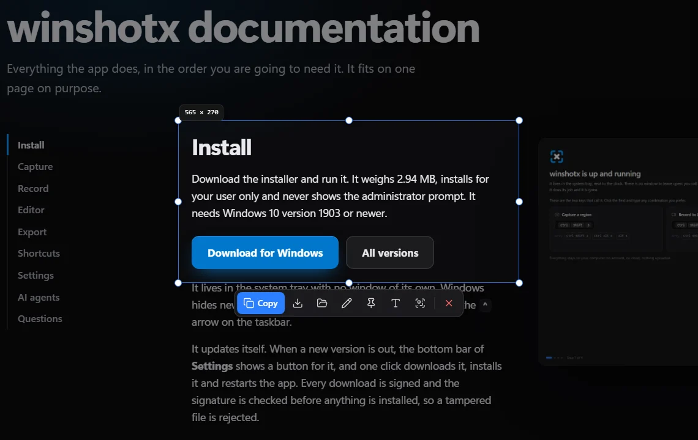
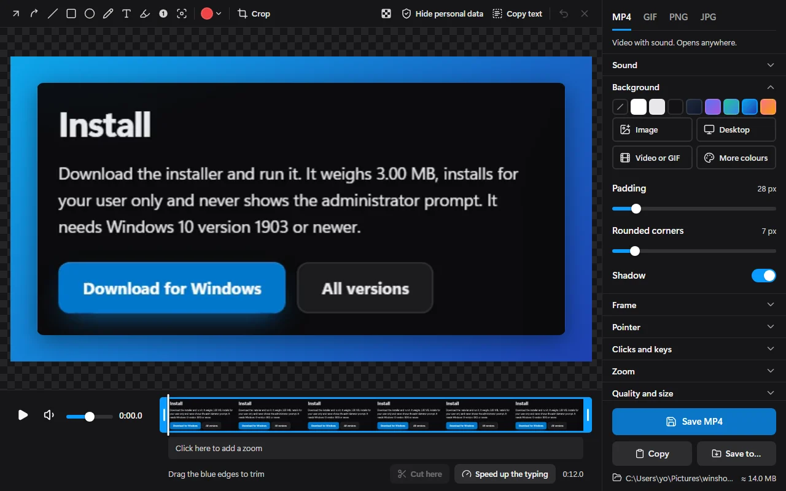
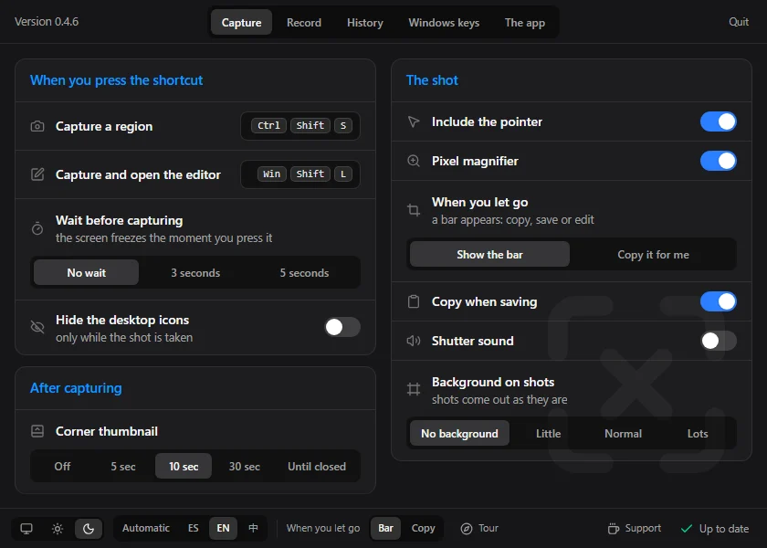

<div align="center">

<picture><source media="(prefers-color-scheme: dark)" srcset="docs/img/logo.svg"></picture>

# winshotx

**Crop the screen before you blink**

A free and open source **Snipping Tool alternative for Windows**: region screenshots with a pixel
magnifier, **GIF and MP4 screen recording**, and an editor with a studio. It shows the selection
already painted 114 ms after the shortcut with three screens, uses 33 MB of memory and fits in a
3.03 MB installer. No account, no cloud, no telemetry and no bundled FFmpeg.

<a href="https://github.com/Mun1to/winshotx/releases/latest/download/winshotx-setup.exe"><picture><source media="(prefers-color-scheme: dark)" srcset=".github/readme/download-windows-dark.svg"></picture></a>
<a href="https://github.com/Mun1to/winshotx/releases/latest"><picture><source media="(prefers-color-scheme: dark)" srcset=".github/readme/download-linux-dark.svg"></picture></a>
<a href="https://winshotx.com/en/"><picture><source media="(prefers-color-scheme: dark)" srcset=".github/readme/download-web-dark.svg"></picture></a>
<a href="https://apps.microsoft.com/detail/9P1NKWNRXD6Z"><picture><source media="(prefers-color-scheme: dark)" srcset="https://get.microsoft.com/images/en-us%20light.svg"></picture></a>

Licence MIT · Windows 10 and 11, and Linux · Installer 3.03 MB

[Compare with the Snipping Tool](#snipping-tool-against-winshotx) · [home page](https://winshotx.com/en/) · [Latest version](https://github.com/Mun1to/winshotx/releases/latest) · [Español](README.es.md)

</div>

https://github.com/user-attachments/assets/2d87de58-39de-4752-aeb1-53ee16e9f41b

## How it works

<p align="center"><picture>
<source media="(prefers-color-scheme: dark) and (max-width: 600px)" srcset=".github/readme/how-it-works-dark-narrow.svg">
<source media="(max-width: 600px)" srcset=".github/readme/how-it-works-light-narrow.svg">
<source media="(prefers-color-scheme: dark)" srcset=".github/readme/how-it-works-dark.svg">

</picture></p>

**The interface speaks English, Spanish and Chinese**, and follows whichever one Windows is set to;
the bar at the bottom of the settings pins another. The identifiers and comments in the source are in
Spanish; the commits, this page and the [home page](https://winshotx.com/en/) are in English.

## What it does

### Capture over a frozen screen

<p align="center"></p>

Press <kbd>Ctrl</kbd> + <kbd>Shift</kbd> + <kbd>2</kbd> and the screen freezes, so nothing moves while you drag. A **6× magnifier** shows the exact colour under the pointer and `C` copies it, and one click takes a **whole window**. Let go and a bar offers copy, save, edit, pin or read the text.

- `F`, `G` and `V` choose what comes out before you crop: photo, GIF or video.
- `S` takes a **long page**, scrolling it by itself. `X` locks the crop to 16:9, 1:1, 9:16 or 4:3.
- No bar if you prefer: the shot goes straight to the clipboard. The welcome asks on the first run.
- Would you rather press **Print Screen** or **Win + Shift + S**? **Settings > Windows keys** takes them from the Snipping Tool, and gives them back.

### Record, then edit with a studio

<p align="center"></p>

Record a region, a whole screen or **one window**, even when something covers it. System sound and the microphone go **each on its own track**, and your webcam can go on top. The editor trims on a timeline, **zooms in on every click**, and adds a background, rounded corners, a shadow and a smooth pointer, all of it **shown live** before you export to MP4 or GIF.

To send an edited recording to another program, choose its executable under **Settings → Record → External video editor**. In the studio, select **MP4** and click **Open in external editor**. winshotx saves the export in the selected folder and then opens it.

Enter optional arguments one per line. Use `{file}` wherever the program expects the exported file path, or leave it out to append the path automatically. Paths containing spaces stay in a single argument. For Tuck's cut editor, choose `Tuck.exe` and use the arguments below.

```text
--sendto-task
cut
{file}
```

### Settings that show what they do

<p align="center"></p>

Eight sections, a **search box** (`Ctrl+F`) that finds any setting by its name, and on the right, **How it will look** draws what you are choosing before you try it.

### And also

- **Cover up personal data.** One click finds the emails, phone numbers, cards, bank accounts and ID numbers, in a picture or in a video, and the mosaic **destroys the pixels** instead of smudging them. A card has to pass its check digit, so an invoice does not come out half covered.
- **The last few seconds.** It can record all the time in memory, and `Ctrl+Shift+6` keeps the last 15, 30 or 60 seconds. The good part almost always happens **before** anyone presses record.
- **Text out of an image.** `T` reads it with Windows' own OCR and copies it, on a recording too.
- **Pin a shot.** `A` leaves it floating on top of everything, right where it was.
- **Eleven marks.** Arrows, boxes, text, highlighter, focus, mosaic and numbered steps that renumber themselves.
- **Faster where nothing happens.** Export at 0.5×, 2× or 4×, or press **Speed up the typing**.
- **A timer.** 3 or 5 seconds before the screen freezes, to photograph an open menu.
- **Pastes where you need it.** An image pastes as an image, and a GIF or MP4 as a **file** into Slack, Discord or Explorer.
- **Everything stays on your PC.** No account, no telemetry, no uploads: the only network call checks GitHub for a new version.

## Snipping Tool against winshotx

Same machine with Windows 11, three runs each, both starting from cold. The clock stops when the
selection is on screen, already painted. The [full comparison](https://winshotx.com/en/#comparativa)
puts winshotx against ten other tools, row by row, and says where each of them wins.

|  | winshotx | Snipping Tool |
|---|---|---|
| From shortcut to the selection on screen, already painted (three screens) | **114 ms** | 920 ms |
| Memory while capturing | **33 MB** | 253 MB |
| Memory sitting idle | **31 MB** | 98 MB |
| A video with zooms that follow your clicks, and a background | **yes** | no |
| Keep the last seconds without pressing record | **15, 30 or 60 s** | no |
| Record GIF | **yes** | Insider builds only, 30 s |
| Cover up personal data | **by itself, in pictures and videos** | emails and phone numbers |
| Draw on top | **eleven marks, with text and numbered steps** | no text or steps |
| A long page, scrolling by itself | **yes** | no |
| System sound and microphone | **each on its own track** | yes |
| Pick your own shortcut | **yes** | no |
| An AI agent can drive it | **yes** | no |
| Timer before capturing | 3 or 5 seconds | **3, 5 or 10 seconds** |
| Comes with Windows | no | **yes** |
| Languages | 3 | **64** |

## Shortcuts

| Shortcut | What it does |
|---|---|
| <kbd>Ctrl</kbd> + <kbd>Shift</kbd> + <kbd>2</kbd> | Capture a region |
| <kbd>Win</kbd> + <kbd>Shift</kbd> + <kbd>L</kbd> | Capture and go straight to the editor |
| <kbd>Ctrl</kbd> + <kbd>Shift</kbd> + <kbd>5</kbd> | Record a region · press again to stop |
| <kbd>Ctrl</kbd> + <kbd>Shift</kbd> + <kbd>6</kbd> | Keep the last few seconds · while that ring is on |
| <kbd>Ctrl</kbd> + <kbd>Shift</kbd> + <kbd>9</kbd> | Zoom in while recording |
| <kbd>Print Screen</kbd> · <kbd>Win</kbd> + <kbd>Shift</kbd> + <kbd>S</kbd> | Capture a region · once **Settings > Windows keys** takes them |

Every one of them changes in the settings: click the field and type the new combination. If another program already holds it, the field turns red and says so.

<details>
<summary><b>While you select</b></summary>

| Key | What it does |
|---|---|
| <kbd>Enter</kbd> | Copy the selection |
| <kbd>Ctrl</kbd> + <kbd>S</kbd> | Save it to the shots folder |
| <kbd>Ctrl</kbd> + <kbd>Shift</kbd> + <kbd>S</kbd> | Save it wherever you want |
| <kbd>E</kbd> | Open it in the editor |
| <kbd>A</kbd> | Pin it on top of everything |
| <kbd>T</kbd> | Copy the text inside it |
| <kbd>C</kbd> | Copy the colour under the pointer |
| <kbd>F</kbd> / <kbd>G</kbd> / <kbd>V</kbd> | Photo, GIF or video |
| <kbd>W</kbd> | Record only the window under the pointer, even when something covers it |
| <kbd>S</kbd> | A long page, scrolling by itself |
| <kbd>X</kbd> | Lock the crop: free, 16:9, 1:1, 9:16 or 4:3 |
| <kbd>R</kbd> | The same area as last time |
| <kbd>P</kbd> | A whole screen: each monitor shows its number, and <kbd>1</kbd>, <kbd>2</kbd> or <kbd>3</kbd> takes it |
| <kbd>B</kbd> | Show or hide the bar |
| <kbd>Ctrl</kbd> + <kbd>A</kbd> | The whole monitor |
| <kbd>←</kbd> <kbd>↑</kbd> <kbd>></kbd> <kbd>↓</kbd> | Move the selection · <kbd>Shift</kbd> in steps of 10 · <kbd>Alt</kbd> resizes |
| <kbd>Esc</kbd> | Cancel |

</details>

<details>
<summary><b>In the editor, and on a pinned shot</b></summary>

| Key | What it does |
|---|---|
| <kbd>Space</kbd> | Play the piece you keep |
| <kbd>I</kbd> / <kbd>O</kbd> | Cut in and out where the preview is |
| <kbd>←</kbd> <kbd>></kbd> | One frame back or forward |
| <kbd>1</kbd> to <kbd>0</kbd> | Arrow, box, text, highlighter, numbered step, mosaic, curved arrow, line, ellipse and pen |
| <kbd>F</kbd> | Focus: darkens everything else |
| <kbd>C</kbd> | Crop the image |
| <kbd>T</kbd> | Copy the text in the picture |
| <kbd>D</kbd> | Cover up the personal data it finds |
| <kbd>Ctrl</kbd> + <kbd>Z</kbd> | Undo the last mark |
| <kbd>Ctrl</kbd> + <kbd>S</kbd> | Export with what the panel has set |
| <kbd>Ctrl</kbd> + <kbd>Shift</kbd> + <kbd>S</kbd> | Export, asking where first |
| <kbd>Esc</kbd> | Let go of the crop or the tool, then close |

On a pinned shot, <kbd>Ctrl</kbd> + <kbd>C</kbd> copies it, <kbd>Ctrl</kbd> + <kbd>S</kbd> saves it, <kbd>T</kbd> copies its text and <kbd>Esc</kbd> closes it.

</details>

<details>
<summary><b>How it takes Print Screen and Win + Shift + S from Windows</b></summary>

`Print Screen` belongs to the Snipping Tool through a per-user registry value, so registering the key alone looks like it worked and never fires. The switch clears that value and takes the key, and turning it off puts the value back exactly as it was.

`Win+Shift+S` is answered by Windows ahead of any program, hook or hotkey. The only way to take it is turning the S off in `DisabledHotkeys`, which costs `Win+S`, the search. The desktop only reads that list when it starts, so the **Apply** button restarts Explorer: two seconds, and nothing else closes. Switching it off puts everything back.

To remove the Snipping Tool altogether, the app opens the Windows screen where that is done, and never uninstalls anything by itself.

</details>

## Install

[**Download the installer**](https://github.com/Mun1to/winshotx/releases/latest/download/winshotx-setup.exe)
· 3.03 MB · it installs for your user only, so Windows never asks for administrator rights. Older
versions are in [Releases](../../releases).

Three other ways, same app:

- **winget:** `winget install Mun1to.winshotx`
- **[Microsoft Store](https://apps.microsoft.com/detail/9P1NKWNRXD6Z):** Microsoft signs the package and the Store keeps it updated.
- **Portable:** `winshotx-<version>-portable-x64.zip` from [Releases](../../releases): one executable, nothing installed, settings in `%APPDATA%\winshotx`.

It lives in the system tray, with no window of its own: if you cannot see it, look behind the `^` arrow on the taskbar.

**It updates itself.** When a new version is out, the settings show a button, and one click downloads it, installs it and restarts the app. Every download is signed, and the signature is checked before anything is installed, so a tampered file is rejected.

**On Linux**, with X11 or with GNOME on Wayland, every release since 0.6.0 carries three packages in
[Releases](../../releases/latest):

- **.deb** for Debian and Ubuntu: `sudo apt install ./winshotx_<version>_amd64.deb`
- **.rpm** for Fedora: `sudo dnf install ./winshotx-<version>-1.x86_64.rpm`
- **AppImage** for the rest: `chmod +x winshotx_<version>_amd64.AppImage` and open it. **It does not save MP4 video**, only GIF, PNG and JPG: for MP4, use the .deb or the .rpm.

The .deb and the .rpm write MP4 with the system's GStreamer. Where its H.264 encoder is missing (Ubuntu without `gstreamer1.0-plugins-bad`), the export panel says so and gives the command that installs it. What changes on Linux, and what has been tested where, is in [packaging/linux](packaging/linux/README.md).

## For AI agents

An AI agent (Claude Code, Codex, Cursor or any other MCP client) can drive winshotx on its own:
it records the screen, stops, exports a finished MP4 or GIF and takes screenshots, and it is told
where each file ended up. To add it to Claude Code, run this in PowerShell:

```
claude mcp add --scope user winshotx -- "$env:LOCALAPPDATA\winshotx\winshotx.exe" mcp
```

That is where the installer and winget put it, unless you picked another folder (the guide has a
line that finds it); with the portable build, use the folder you unzipped it into.
Without MCP, `winshotx.exe agent` does the same from any terminal and answers
with one line of JSON. **A recording started by an agent looks exactly like one of yours**, with
the frame and the bar, so you always know when the screen is being recorded. How to add it to
every agent, and every command: [docs/AGENTS-API.md](docs/AGENTS-API.md).

## Is this what you were looking for?

- **"I want a Snipping Tool alternative for Windows."** This is it, and it opens 8 times sooner. The
  Snipping Tool still comes with Windows and speaks 64 languages; the table above says where each one wins.
- **"How do I record a GIF of my screen on Windows?"** Press `Ctrl+Shift+5`, drag over the area,
  press it again to stop, and export to GIF from the editor. No FFmpeg to install.
- **"I need a lightweight screen recorder that does not eat my RAM."** 33 MB while capturing,
  31 MB waiting in the tray.
- **"Something like ShareX, but simpler."** The same global shortcuts and the same
  frozen-screen overlay, without the hundreds of settings.
- **"I want to pick a colour off the screen."** The magnifier gives you the hex code of the pixel
  under the cursor at 6× zoom, and `C` copies it.
- **"Does it upload my screenshots anywhere?"** No. There is no account, no telemetry and no
  network calls other than checking for updates on GitHub.

## How it is built

| Layer | Choice | Why |
|---|---|---|
| Desktop | [Tauri 2](https://tauri.app) | small binary, system webview, Rust backend |
| Updates | Tauri `updater` plugin, minisign signatures | one button, without leaving the app or installing blind |
| Interface | React 19 + Vite + Tailwind 4 + framer-motion | independent windows, native feeling animation |
| Still capture | [`xcap`](https://crates.io/crates/xcap) | enumerates monitors and windows with their real coordinates |
| Recording | [`windows-capture`](https://crates.io/crates/windows-capture) | Windows Graphics Capture, 60 fps at no CPU cost |
| MP4 | Media Foundation, hardware H.264 | 0 MB of dependencies, system acceleration |
| GIF | [`gif`](https://crates.io/crates/gif) + [`color_quant`](https://crates.io/crates/color_quant) | global palette, dithering and frame differencing |
| Editing cache | lossless [QOI](https://qoiformat.org) | fast to write and editable frame by frame |

**The selection overlay is not a transparent window.** The screen is captured, shown frozen, and
the selection happens on top of that image. It sidesteps the Tauri v2 transparency bug on Windows,
removes the flicker of moving content underneath, and gives a pixel exact magnifier for free.

**No bundled FFmpeg.** MP4 is written by Media Foundation in hardware, and the GIF is produced in
pure Rust with a global palette, Floyd-Steinberg dithering and writing only the rectangle that
changed between frames. If you happen to have `ffmpeg` on your `PATH`, the editor offers a maximum
quality engine (`palettegen`) as well, but it is never downloaded and never shipped.

[`docs/TRAMPAS.md`](docs/TRAMPAS.md) (in Spanish) collects the 52 traps of Tauri v2 and Windows that
cost hours of debugging, each with what it looks like, why it happens and how it was fixed: synchronous
commands that freeze the interface, windows that must not be created from a global shortcut thread, a
CSP that only fails in the installer, a window asking for a size it has no permission for, and the
signing key that is passed one way and not the other.

**Windows and Linux.** It runs on Windows 10 1903 or newer and, since 0.6.0, on Linux with X11 or
with GNOME on Wayland. Everything that touches the system is behind `#[cfg(windows)]` or
`#[cfg(target_os = "linux")]`; what changes on Linux is in [packaging/linux](packaging/linux/README.md).

<details>
<summary><b>Building it yourself</b></summary>

```bash
pnpm install
pnpm approve-builds --all
pnpm tauri dev      # starts the app (it lives in the system tray)
pnpm tauri build    # NSIS installer in target/release/bundle/nsis
```

Backend tests are not pretend: they capture the real screen, record a clip through Windows Graphics
Capture and export GIF and MP4 files that are then read back to check they are valid.

```bash
cd src-tauri
cargo test
```

The site lives in [`frontlaxweb/`](frontlaxweb) and Cloudflare Pages serves it. Every push runs
the checks and then deploys, so the English pages, the asset hashes and the sitemap all have to
agree first:

```bash
node frontlaxweb/generar-en.mjs      # rebuild /en/, the FAQ schema and the asset hashes
python frontlaxweb/generar-social.py # rebuild both 1200x630 cards
node frontlaxweb/hacer-imagenes.mjs  # retake the app pictures from dist/, after pnpm build
```

Publishing a version needs the private signing key, which is **not in this repository** and without
which the updater would reject the download:

```bash
export TAURI_SIGNING_PRIVATE_KEY="$(cat ~/.tauri/winshotx.key)"
export TAURI_SIGNING_PRIVATE_KEY_PASSWORD=""   # the key was generated without one
pnpm tauri build
node scripts/publicar.mjs --publicar   # writes latest.json and creates the release
```

`publicar.mjs` refuses to run if `package.json` and `Cargo.toml` disagree on the version, or if the
`.sig` is older than the installer, which is what happens when you build without the key.

After publishing, `node scripts/verificar-firma.mjs` downloads what the release actually serves and
checks the signature against the public key inside the app, with ed25519 over BLAKE2b-512. A
signature made with a different key is the one failure that gives no error at all: the updater
quietly refuses every download and every installed copy stays where it is.

The winget manifests are in [`packaging/winget`](packaging/winget).

</details>

## Licence

[MIT](LICENSE). Use it, change it and sell it if you want. Built by
[Munir Torres](https://munito.dev).

<br>

<p align="center">Made by <a href="https://munito.dev"><b>Munir Torres</b></a>. Also by him: <a href="https://adeorq.com">Adeorq</a> · <a href="https://vocript.app">VoCript</a> · <a href="https://github.com/Mun1to/Expoal">Expoal</a> · <a href="https://github.com/Mun1to/hotkeyconfig">hotkeyconfig</a> · <a href="https://github.com/Mun1to/froede">froede</a></p>
